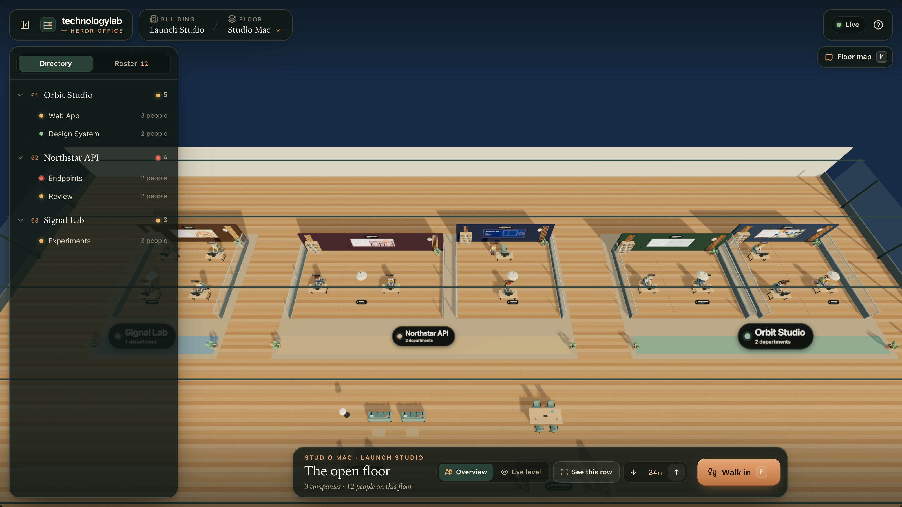
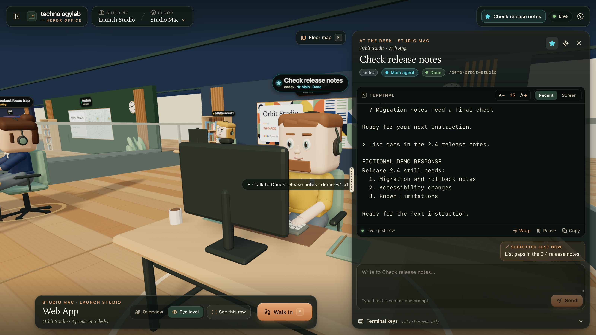
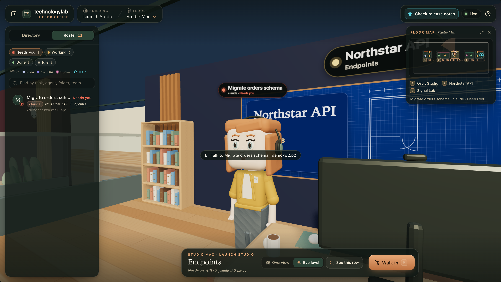
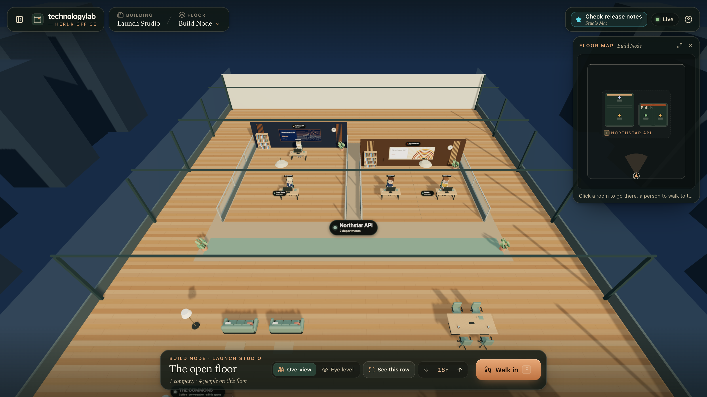

# technologylab · Herdr Office

A local, first-person 3D office for live Herdr sessions. Companies and departments come from your actual workspace tree. Each pane has a computer, and each agent that Herdr reports has a human character at that desk. No additional agents are inferred or invented.

[](docs/images/demo-overview.png)

<table>
  <tr>
    <td width="33%"><a href="docs/images/demo-desk.png"></a></td>
    <td width="33%"><a href="docs/images/demo-roster.png"></a></td>
    <td width="33%"><a href="docs/images/demo-floors.png"></a></td>
  </tr>
  <tr>
    <td><b>Visit a desk.</b> Read the terminal and send a prompt.</td>
    <td><b>Find who needs you.</b> Filter the roster by status.</td>
    <td><b>Change floors.</b> Each machine is a floor.</td>
  </tr>
</table>

*Screenshots from the fictional demo below. The running app shows your real Herdr sessions.*

## Get the source

With Git and Node.js 22.12+ installed:

```sh
git clone https://github.com/technologylab-ai/herdr-office.git
cd herdr-office
npm ci
```

## Try the demo

Explore a fictional office before connecting anything. Only Node.js 22.12+ is required.

```sh
npm run demo
```

Open **http://127.0.0.1:5186**. The command builds the app, then serves it with an isolated, in-memory scripted API. It makes no Herdr, Codex, Ollama or SSH calls. The office holds 16 fictional agents on two floors: 12 on *Studio Mac* across three companies, and 4 on *Build Node*. Prompts and terminal responses are simulated; nothing you type reaches a real agent. `Ctrl+C` stops the demo. The real app runs separately, with `npm run dev`, or `npm run build` then `npm start`, as described below.

Demo screenshots can be reproduced with the [capture guide](scripts/marketing/README.md).

## Run

Requires Node.js 22.12+ (or a compatible newer Node release) and Herdr. Start the bridge from a **Herdr-managed terminal**, so it inherits `HERDR_ENV=1` and the correct session context.

```sh
npm run dev
```

Open **http://127.0.0.1:5173**. To use a browser on another computer, forward that port to this Mac:

```sh
ssh -N -L 5173:127.0.0.1:5173 your-mac-ssh-target
```

Then open http://127.0.0.1:5173 on that computer. You can add the same `-L` option when starting your usual SSH session. Neither the office nor its API listens on a public network interface.

For the built version, stop the development server first:

```sh
npm run build
npm start
```

The built app and API share **http://127.0.0.1:4318**. Forward port 4318 instead when using that version remotely. `Ctrl+C` stops the office service; it does not stop Herdr or your agents.

## Explore

- **F** (or **Walk in**) captures the mouse. Move with WASD or arrows (6 m/s); Shift runs (14 m/s); Escape frees the cursor. You can pass through interior walls and furniture; only the outer floor edge limits movement. Shortcuts are inactive while typing into a field.
- Scroll over the 3D view to smoothly approach or retreat; hold Shift to cover more ground. In overview, scrolling zooms along the viewing direction. Scrolling the terminal or directory still scrolls that panel.
- **Overview** raises the viewpoint and frames the current row of companies; **V** switches between overview and eye level, and **R** frames the row again. Overview can pull back beyond the perimeter when zooming. Separate wall-mounted signs identify each company and department on both sides of the back wall.
- The floor map shows the real departments, desks, agents and your position. Click a room to jump there, or an agent to visit their desk. Press **M** to open the map and release the cursor; it toggles the map while the cursor is already free.
- Drag the scene to look around without mouse capture.
- The office renders at 5 fps while idle, wakes to the display frame rate for movement or looking around, and pauses drawing in hidden tabs. Ambient status pulses rest while idle; their colors, labels and live updates remain visible. Model detail and lighting stay the same.
- **E** opens the terminal of the person, chair, or computer in the centre of your view within 3.2 metres. The hint follows your gaze and disappears when you look away. You can also click a person, chair, or computer.
- The **Directory** jumps to a real company or department. The **Roster** finds agents by name, workspace, or folder and takes you to their desks.
- Select a desk to read recent terminal output or its current screen. Drag the panel’s left-edge grip to widen it; double-click the grip to reset. A− / A+ changes the terminal font size. Panel width and font size are saved in this browser. Pause, wrap, copy, and scroll the output. The selected physical monitor also displays the actual screen content.
- Overhead labels show the task and agent type. Idle ages are color-coded: under five minutes, five to thirty minutes, and over thirty minutes. The ≥ symbol means the bridge has observed at least this much idle time; Herdr does not expose historical idle timestamps.
- Star an agent in its desk panel to bookmark it as your main agent. The top-bar shortcut finds that exact agent across floors. This is a browser bookmark, and does not create a Herdr role or transfer to a replacement terminal.
- Send text prompts to idle/done agents. Working, blocked, and unknown agents cannot receive a normal prompt; this avoids pasting into an unrelated terminal dialog.
- Expand **Terminal keys** for arrows, Tab, Enter, Escape, and interrupt. Enter, Escape, and Ctrl+C deliberately require two clicks. The application never selects a permission answer itself.
- Press **?** for the controls and mapping guide. Smaller screens support directory navigation, drag-to-look, and the terminal drawer.

## Spatial mapping

| Herdr | Office |
| --- | --- |
| Named session | Building |
| Local or saved SSH machine | Floor |
| Sidebar workspace | Company |
| Tab | Department |
| Pane rectangle | Desk area |
| Reported agent | Human at that computer |

The floor plan preserves pane ordering, shared edges and ordinary split ratios on each axis. Terminal cells become metres, with a minimum usable desk area and aisles between departments and companies. When a tiny terminal strip would inflate an entire department, only the intervals that need extra desk space are stretched; those extreme layouts have adjusted proportions. Zooming a Herdr pane does not remove its neighboring desks. Idle and done agents stay seated at their desks. Plain terminal panes without a currently reported agent have an empty chair; recent use alone does not establish an occupant. Agents removed from Herdr disappear from the office. Sub-agents are only included if Herdr reports them.

Live snapshots update through SSE, with bounded CLI polling. Connection and terminal identity are checked again before input is submitted. A successful send means terminal delivery, not completion of the agent's work. If a terminal is replaced, its draft and input confirmation reset. The current Herdr pane-targeted API still leaves a small replacement race during dispatch; see [the bridge documentation](server/README.md).

## Original Blender kit

The office uses original, meter-scale Blender models: seated/standing humans, computer desks, chairs, plants, coffee station, water cooler, bookshelves, sofas, floor lamps, meeting tables, and clocks. GLBs are already included, so **Blender and MCP are not required to run the app**.

- Editable source: `assets/office-kit.blend`
- Modeling script: `scripts/build_models.py`
- Browser assets: `public/models/`

Regenerate the assets with Blender installed:

```sh
npm run models
```

The launcher finds Blender on PATH or in the standard macOS application location; set BLENDER_BIN to an executable path to override it. The script starts a separate factory-default background Blender instance and does not modify your open Blender scene. Static meshes are consolidated by material; screens and animated character parts remain separate. Four character styles include two male designs (short beard and glasses/quiff) and two female designs (bob/cardigan and high bun/blouse), each in seated and standing poses. Fresh floor rosters use roughly half female artwork, rounding up for odd counts. Model assignments stay attached to the terminal occupant during status changes and floor switches. New occupants fill gaps in the mix; removing agents preserves the remaining occupants' appearances. The original characters use a light complexion palette, rounded-square heads, compact bodies, office clothing, headsets, and separately animated hands and heads. Working agents type; agents waiting for input stand beside their desks. The branding is technologylab; the reference product's assets and branding are not used.

## Validate

```sh
npm test
npm run test:browser
npm run build
```

Browser tests use an isolated browser and intercept every API request. Test fixtures never reach your live agents, and testing requires no Herdr session, Codex login or Blender installation. On macOS, an installed Chrome is used automatically. Otherwise install Playwright Chromium first:

```sh
npx playwright install chromium
```

Set `PLAYWRIGHT_CHROMIUM_EXECUTABLE_PATH` to use a different local browser executable. GitHub Actions runs unit tests, the production build and the isolated browser suite on Linux. Browser tests run in three shards with longer time limits for software WebGL; failed runs retain screenshots and traces.

For software rendering, `VITE_OFFICE_RENDER_QUALITY=low` disables shadows and antialiasing and lowers rendering resolution while retaining all scene geometry and interactions. CI uses this setting. Set `HERDR_OFFICE_TEST_PORT` to run tests beside an existing development server, for example:

```sh
VITE_OFFICE_RENDER_QUALITY=low HERDR_OFFICE_TEST_PORT=5180 npm run test:browser
```

## Implementation

- React/TypeScript and Vite for the interface, authored with Claude Opus 5.5.
- Three.js for the navigable world, floor boundaries, live human states, and monitor rendering.
- Blender for original editable assets.
- Node HTTP bridge for explicit-target Herdr CLI operations, local sessions, saved SSH profiles, SSE, terminal reads, and guarded input.

The floor picker includes local sessions and sessions on enabled SSH machines saved in Herdr. Configure remote machines in Herdr before launching the office. Every existing session on those saved machines is discovered read-only; the app does not install Herdr or create sessions on remote hosts. Integration has been verified with Herdr 0.9.0, and remote routing also has automated coverage.

Task labels are refined in background batches by GPT-6 Luna through the locally logged-in Codex CLI. Only Herdr task titles, pane labels, and directory basenames are supplied; terminal transcripts are not read for naming. Original Claude/Codex/etc. provider fields stay intact. Title labels appear immediately, inference never blocks polling, and failures fall back to those titles. Calls are cached and limited to one batch per minute. To use titles without model refinement:

```sh
HERDR_OFFICE_LABEL_MODEL=off npm run dev
```

Voice, a chief-of-staff agent, persistent chat archives, and office layout editing are outside this initial version. Terminal history is whatever Herdr exposes; alternate-screen output that Herdr has discarded cannot be recovered here.
